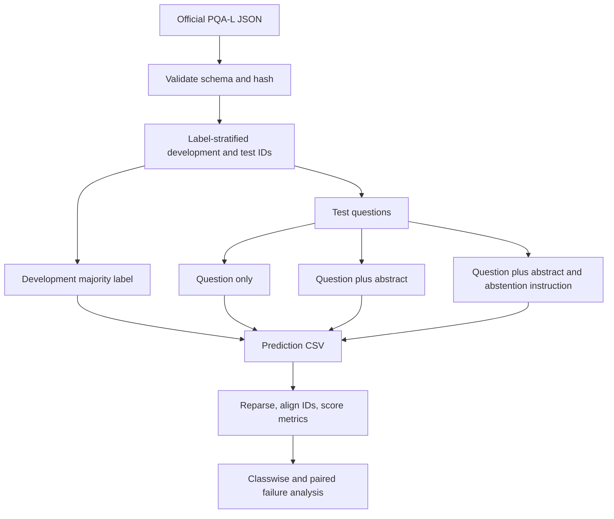

# Actual experimental protocol (reconstructed) — Prompt 07

**Historical status:** This document was reconstructed from the already-executed Colab notebook and its saved outputs. It was **not** independently frozen or pre-registered before test inference. Treat it as an accurate retrospective record, not evidence of prospective preregistration.

1. **Task:** classify the PubMedQA expert-annotated biomedical question as `yes`, `no`, or `maybe`.
2. **Data:** official PQA-L file; custom stratified 800/200 development/test split (seed 20261113). Ground truth and `LONG_ANSWER` excluded from the model prompt. Dataset source and hash are in `results/dataset_validation.json`.
3. **Methods:** development-majority `yes`; direct question-only; supplied abstract with matching question; matching abstract plus permission to answer `abstain` on insufficient evidence.
4. **Model and fixed settings:** `Qwen/Qwen2.5-0.5B-Instruct`, Tesla T4, float16, left padding, Qwen chat template, batch size 8, greedy generation, 4 new tokens maximum. No weights updated, no retrieval stage. Exact model revision unresolved.
5. **Response parser:** strip whitespace, lowercase, exact `yes|no|maybe|abstain` with optional trailing `.` or `!`. `abstain` valid only in the abstention condition; otherwise `invalid`. This strict parser is part of the protocol and may suppress explanatory responses.
6. **Primary outcomes:** overall accuracy (unanswered/invalid counted incorrect), macro-F1 over three benchmark classes. Secondary: coverage, selective accuracy, invalid rate, abstention rate, classwise performance, mean batch-generation seconds/item, paired error changes.
7. **Validity and leakage:** same 200 test PMIDs and same gold labels in every condition; no model selection on test labels was recorded. Gold labels used to form a stratified split; no prompt access to labels. Model pretraining contamination unassessed.
8. **Deeper analysis:** per-class precision/recall/F1, confusion matrices, prediction class collapse, and paired gain/loss table (independently computed after execution).

**Not claimed:** cross-domain generalization, true RAG or retrieval, reliability of cited sources, verified mechanistic reasoning, clinical validity, statistically powered significance, multiple independent seeds, official PubMedQA leaderboard reproduction.

**Future prospective protocol:** freeze seeds, dataset version and model revision; preselect prompts on development examples; evaluate a new held-out test set only once; add length-matched irrelevant context control; report confidence intervals and replicates.
